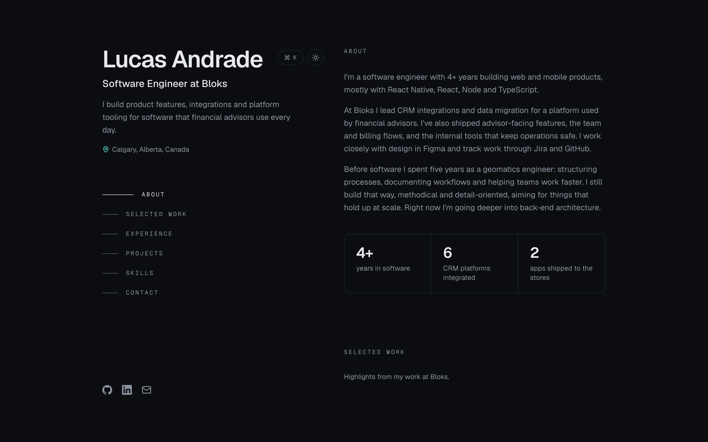
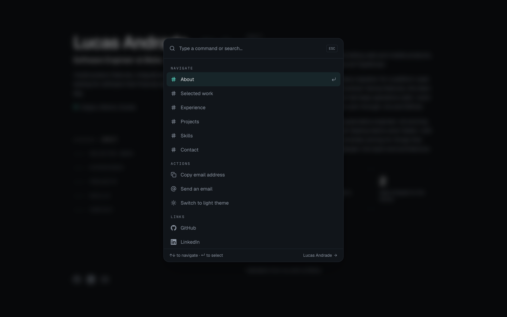
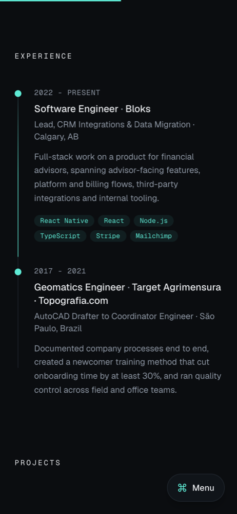

<div align="center">

<h1>Lucas Andrade</h1>

<p>
  Personal portfolio of a software engineer building product features,<br />
  CRM integrations and platform tooling with React Native, React, Node and TypeScript.
</p>

<p>
  <a href="lucas-andrade-react-portfolio.vercel.app"><strong>lucas-andrade-react-portfolio.vercel.app</strong></a>
  &nbsp;·&nbsp;
  <a href="https://www.linkedin.com/in/lucas-silva-de-andrade/">LinkedIn</a>
  &nbsp;·&nbsp;
  <a href="mailto:andradelucas94@gmail.com">Email</a>
</p>

<p>
  
  
  
  
</p>

<br />

<picture>
  <source media="(prefers-color-scheme: dark)" srcset="./.github/assets/desktop-dark.png" />
  <source media="(prefers-color-scheme: light)" srcset="./.github/assets/desktop-light.png" />
  
</picture>

</div>

<br />

## Overview

A single-page portfolio built to be quick to scan. On desktop, a sticky sidebar holds the name, role, section navigation and contact links while the content scrolls beside it. On mobile the layout stacks, and a floating menu button opens a command palette for navigation.

The site is organised into **About**, **Selected work**, **Experience**, **Projects**, **Skills** and **Contact**.

## Features

| | |
| --- | --- |
| **Command palette** | <kbd>⌘</kbd> <kbd>K</kbd> or <kbd>Ctrl</kbd> <kbd>K</kbd> jumps to any section, copies the email address, switches theme or opens GitHub and LinkedIn. Fully keyboard-driven. |
| **Light and dark themes** | Follows the system setting until the visitor chooses a theme, remembers the choice, and applies it before first paint so the page never flashes the wrong colours. |
| **Scroll-aware navigation** | The sidebar highlights the section in view, and a thin progress bar tracks how far down the page you are. |
| **Experience timeline** | The timeline line fills as you scroll, and each role's dot lights up when you reach it. |
| **Subtle motion** | Content blurs and fades in, stats count up when they come into view, hovering a card dims the others, and a soft spotlight follows the cursor. |
| **Live local time** | The footer shows the current time in Calgary. |
| **Accessible** | Semantic landmarks, a skip-to-content link, labelled controls, and no motion at all for visitors who prefer reduced motion. |
| **Lightweight** | The only runtime dependencies are React and Lucide. Every effect is plain CSS or a small custom hook. |

## Screenshots

<table>
  <tr>
    <th width="66%">Command palette</th>
    <th width="34%">Mobile</th>
  </tr>
  <tr>
    <td>
      <picture>
        <source media="(prefers-color-scheme: dark)" srcset="./.github/assets/palette-dark.png" />
        <source media="(prefers-color-scheme: light)" srcset="./.github/assets/palette-light.png" />
        
      </picture>
    </td>
    <td>
      <picture>
        <source media="(prefers-color-scheme: dark)" srcset="./.github/assets/mobile-dark.png" />
        <source media="(prefers-color-scheme: light)" srcset="./.github/assets/mobile-light.png" />
        
      </picture>
    </td>
  </tr>
</table>

## Tech stack

| Area | Choice |
| --- | --- |
| UI | [React 19](https://react.dev) |
| Build and dev server | [Vite](https://vite.dev) |
| Styling | [Tailwind CSS 4](https://tailwindcss.com) through `@tailwindcss/vite` |
| Icons | [Lucide](https://lucide.dev), plus inline SVG for brand logos |
| Typography | [Geist and Geist Mono](https://vercel.com/font), served by Google Fonts |

## Getting started

Requires **Node.js 20.19+ or 22.12+**.

```bash
git clone https://github.com/lucas-andrade94/react-portfolio.git
cd react-portfolio
npm install
npm start
```

| Script | Description |
| --- | --- |
| `npm start` | Starts the dev server at `http://localhost:3000` |
| `npm run build` | Creates the production build in `build/` |
| `npm run preview` | Serves the production build locally |

## Editing content

> [!TIP]
> All text on the site lives in [`src/data/content.js`](src/data/content.js). Updating the portfolio never requires touching a component.

| Export | Controls |
| --- | --- |
| `profile` | Name, title, tagline, location, time zone, email and social links |
| `about`, `stats` | About paragraphs and the stats row |
| `work` | Selected work case studies |
| `experience` | Timeline entries |
| `projects` | Side-project cards. Add `{ label, href }` items to `links` to show store or repository buttons. |
| `skills`, `education`, `certifications`, `languages` | Skills section |

Theme colours are CSS variables at the top of [`src/index.css`](src/index.css): `:root` holds the light theme and `.dark` holds the dark theme. Tailwind exposes them as utilities such as `bg-surface`, `text-muted` and `text-accent`.

<details>
<summary><strong>Project structure</strong></summary>
<br />

```
├── index.html                 HTML entry, meta and Open Graph tags, theme bootstrap
├── public/                    Copied as-is to the build (favicon, robots.txt)
├── src/
│   ├── index.jsx              React root
│   ├── App.jsx                Layout, section list, ⌘K shortcut
│   ├── index.css              Theme tokens, Tailwind, animations
│   ├── data/
│   │   └── content.js         All site content
│   ├── assets/                App icons
│   ├── components/
│   │   ├── Sidebar.jsx        Name, navigation, theme toggle, social links
│   │   ├── About.jsx          Bio and stats
│   │   ├── Work.jsx           Selected work
│   │   ├── Experience.jsx     Scroll-beam timeline
│   │   ├── Projects.jsx       Side projects
│   │   ├── Skills.jsx         Skills, education, certifications
│   │   ├── Contact.jsx        Email call to action with copy button
│   │   ├── Footer.jsx         Local time and back-to-top link
│   │   ├── CommandPalette.jsx
│   │   ├── NumberTicker.jsx
│   │   ├── ui.jsx             Section, Card and Tags primitives
│   │   └── icons.jsx          GitHub and LinkedIn logos
│   └── hooks/
│       ├── useTheme.js            Theme state and persistence
│       ├── useActiveSection.js    Scroll-spy for the navigation
│       ├── useScrollProgress.js   Page or element scroll progress
│       └── usePageEffects.js      Reveal on scroll and cursor spotlight
└── vite.config.js
```

</details>

## Deployment

`npm run build` outputs a fully static site to `build/`. Upload the contents of that folder to any static host, such as Apache, Nginx, Netlify, Vercel or GitHub Pages. No server-side code is required.

## Contact

Open to conversations about engineering roles, integrations work and product ideas.

**Email** [andradelucas94@gmail.com](mailto:andradelucas94@gmail.com)
&nbsp;·&nbsp;
**LinkedIn** [lucas-silva-de-andrade](https://www.linkedin.com/in/lucas-silva-de-andrade/)
&nbsp;·&nbsp;
**GitHub** [lucas-andrade94](https://github.com/lucas-andrade94)
